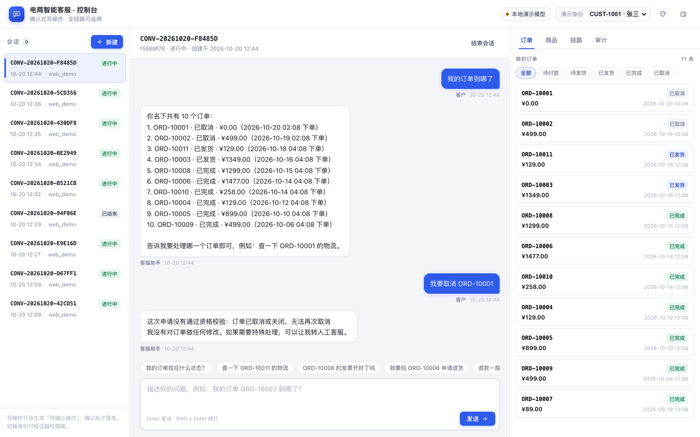
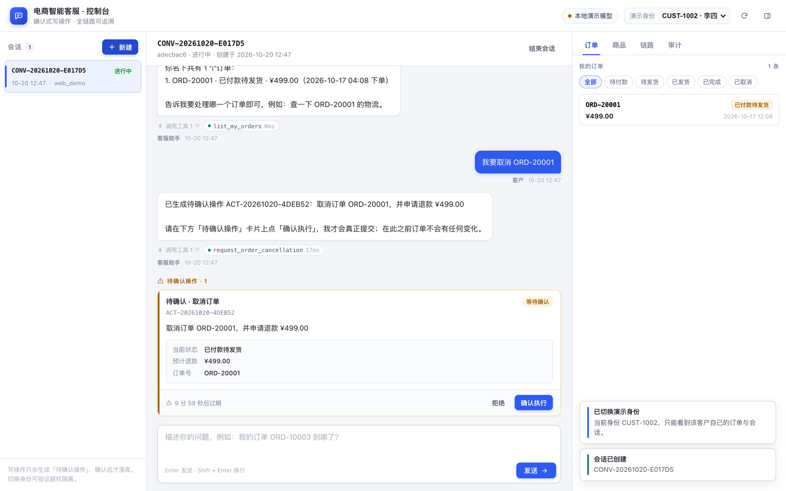
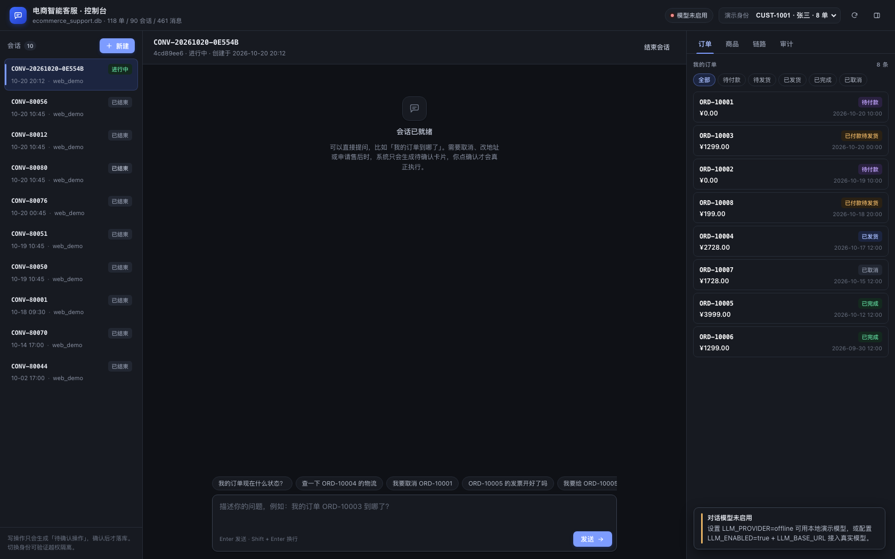

# 电商 AI 客服 MVP（Go + SQLite + Tool Calling）

按 `docs/ecommerce_ai_customer_service_mvp_spec.md` 实现的本地可运行业务系统：大模型通过受控工具查询模拟电商数据，需要办理业务时先生成**待确认操作**，用户显式确认后才在事务中写入并留下审计记录。

- 技术栈：Go 1.22+（`net/http` 路由）、SQLite（`modernc.org/sqlite`，无 CGo）、`database/sql` 显式 SQL、OpenAI-compatible tool calling。
- 单体模块化：一个服务、一个数据库、清晰的包边界，没有 ORM / 消息队列 / 向量库。
- 不接真实支付、物流、发票、客服平台；全部为虚构演示数据。

---

## 1. 快速开始

> 若 `go` 不在 `PATH` 中（例如使用托管工具链），先 `export PATH="$HOME/.workbuddy/binaries/go/bin:$PATH"`，或 `make run GO=/绝对路径/go`。

```bash
# 1) 准备配置（可选：程序也会读 .env，已存在的环境变量优先）
cp .env.example .env

# 2) 写入虚构演示数据（幂等，可重复执行）
make seed

# 3) 启动服务：自动建目录、跑 migration
make run

# 4) 打开浏览器使用控制台（静态页内嵌在同一个进程里）
open http://localhost:8080

# 5) 健康检查
curl http://localhost:8080/healthz
curl http://localhost:8080/readyz

# 6) 或用命令行创建会话（CUST-1001 由 seed 创建）
curl -X POST http://localhost:8080/api/v1/conversations \
  -H 'Content-Type: application/json' \
  -H 'X-Demo-Customer-ID: CUST-1001' \
  -d '{"channel":"web_demo"}'
```

默认 `LLM_ENABLED=false` 时聊天接口返回 `503 llm_unavailable`（用户消息仍会落库）。两种方式让它能对话：离线演示模型（无需密钥）或真实模型。

**A. 离线演示模型**（本地体验用，规则匹配，不是大模型）：

```bash
LLM_PROVIDER=offline make run
```

**B. 真实模型**（支持 tool calling 的 OpenAI-compatible 端点）：

```bash
export LLM_ENABLED=true
export LLM_BASE_URL=https://api.deepseek.com/v1     # 或本地 llama.cpp / vLLM 的 /v1
export LLM_API_KEY=sk-xxx
export LLM_MODEL=deepseek-chat
export LLM_PROVIDER=openai
make run
# 可选：单轮真实链路自检（不进入 CI）
make smoke-llm
```

---

## 2. Web 控制台

控制台由 `web/` 目录内嵌进服务端（`go:embed`），**不需要 node/npm，也没有单独的前端进程**。`make run` 后打开 <http://localhost:8080> 即可。



待确认卡片与工具轨迹（暗色主题见 `docs/screenshots/console-dark.png`）：



| 区域 | 能做什么 |
|---|---|
| 顶栏 | 切换演示身份（下拉从 `/api/v1/dev/customers` 动态列出全部 20 位客户及各自订单数）、查看对话模型模式、全局刷新；标题下方显示当前进程打开的库与规模（如 `ecommerce_support.db · 118 单 / 89 会话`） |
| 左栏 | 新建会话、会话列表（状态 / 时间 / 待确认数量） |
| 中间 | 聊天、工具调用条（工具名 + 状态 + 耗时）、待确认操作卡片（预览 / 倒计时 / 确认 / 拒绝）、快捷提问、失败重试 |
| 右栏 · 订单 | 状态筛选、订单详情、物流轨迹、售后单、发票 |
| 右栏 · 商品 | 关键词搜索、SKU 价格与库存 |
| 右栏 · 链路 | 该会话的工具调用（脱敏入参 / 结果 / 耗时） |
| 右栏 · 审计 | 确认后的 before / after 快照与执行结果 |

推荐的体验顺序：

1. 新建会话 → 输入「我的订单到哪了」，看模型先查列表再追问。
2. 输入「我要取消 ORD-10002」→ 出现待确认卡片（此时订单**尚未**变化，可在右栏核对）。
3. 点「确认执行」→ 聊天里出现执行结果卡，右栏订单状态变成「已取消」，链路/审计出现工具调用与 before-after。
4. 输入「ORD-10003 到哪了」→ 物流轨迹；「我要取消 ORD-10003」→ 资格拒绝（已发货），不会写任何数据。
5. 切到 CUST-1002（或下拉里任意客户）→ 只能看到该客户自己的订单，越权请求返回 403。

界面细节：待确认卡片展示 `pending_actions.preview`（订单号 / 预计退款 / 变更前后值），倒计时到 0 提示过期；发送失败时消息已落库，点「重试」会复用同一个 `client_message_id`，不会重复插入。

### 模型备注（demo 阶段的可解释性）

系统提示词要求模型**每次回复的第一行**先写一句 `备注：<为什么这么做>`（不超过 40 字）。服务端把这一行从正文里解析出来，作为独立字段下发，前端在气泡上方以灰色备注条渲染：

| 场景 | 展示 |
|---|---|
| 调工具的那一轮 | `备注 · 第N轮` + 一句话动机 + 本轮工具名 |
| 直接回答 | `备注` + 一句话动机，紧贴回复气泡 |
| 模型没遵守格式 | 琥珀色「本轮模型没有给出理由」，一眼看出遵循率 |
| 兜底/降级 | 备注说明是轮次用尽还是文本为空 |

- 解析在 `internal/ai/reason.go`（兼容 `<备注>…</备注>`、`备注：`、`【备注】`、markdown 加粗等写法；解析不到就原样保留正文，不会吞答案）。
- 备注存进 `messages.metadata_json`，刷新页面后历史消息仍然显示。
- API：`POST .../messages` 返回 `reasons[]`（`{round, kind, tool_call|answer, reason, tools[]}`），`GET .../messages` 的每条消息带 `reason`。
- 离线演示模型（`LLM_PROVIDER=offline`）也会给出备注，来自 `internal/ai/offline.go` 的 `toolReasons` 规则表，所以没有 API key 也能演示这个效果。

---

## 3. 运营后台（/admin/）

面向客服主管的跨客户视图，与上面的客户控制台同进程、同端口、**不同身份体系**：
客户控制台用 `X-Demo-Customer-ID`（仅 dev）模拟单个客户，后台用账号密码登录，走服务端会话 Cookie。

```bash
make run          # 或 LLM_PROVIDER=offline make run
open http://localhost:8080/admin/
```

首次启动时，若 `admin_users` 为空，会用 `ADMIN_USERNAME` / `ADMIN_PASSWORD` 创建内置管理员；
默认是 `admin / admin12345`，只在 `APP_ENV=dev|test` 下允许，其他环境不换密码会**拒绝启动**。
已有账号时这两个变量被忽略——改环境变量不会重置线上密码，这是刻意为之。

| 分区 | 页面 | 主要看什么 |
|---|---|---|
| 运营 | 概览 | 会话量、自助解决率、工具成功率、待办队列、14 天趋势、意图 Top |
| 运营 | 会话 | 跨客户会话列表；详情含完整消息（含 tool 轮次）、工具轨迹、意图标注、关联订单、审计 |
| 运营 | 工单 | 按优先级与等待时长排序；详情可做状态流转（带状态机校验）并留处理记录 |
| 运营 | 待确认动作 | 客户尚未确认的取消/修改/售后提案；**只能作废，不能代客户确认** |
| 质量 | 工具监控 | 每个工具的调用量、成功率、平均/P95 耗时、主要错误码；可下钻到单次入参与结果 |
| 质量 | 意图分析 | 各意图的样本量、解决率、转人工率、情绪分布 |
| 质量 | 知识库 | 文章增删改查、发布/归档、版本号；内容会被 `search_knowledge` 工具检索 |
| 业务数据 | 客户 / 订单 / 商品 | 客户画像与权益、订单全链路（明细/包裹/支付/退款/售后/发票）、SKU 价格库存 |
| 业务数据 | 售后与财务 | 售后单、退款、发票、促销四个页签 |
| 治理 | 审计日志 | 所有写操作的 before/after 快照与操作人 |
| 治理 | 系统状态 | 迁移版本、各表行数、活跃会话、幂等键规模 |

写操作只有三类，且全部落 `action_audit_logs`（`actor_type=admin`）：工单状态流转与处理记录、
知识库文章增改与发布、作废待确认动作。后台不提供通用 CRUD，也不会修改订单。

---

## 4. 演示数据

`go run ./cmd/seed`（`-reset` 清库重写，仅 dev/test）写入一整套有业务因果关系的虚构数据，
不是随机组合：

| 实体 | 数量 |
|---|---|
| 客户 / 商品 / SKU | 20 / 72 / 123 |
| 订单 / 订单行 | 118 / 168 |
| 支付 / 退款 | 114 / 34 |
| 包裹 / 轨迹 | 100 / 588 |
| 售后单 / 发票 | 38 / 28 |
| 会话 / 消息 / 工具日志 | 89 / 461 / 193 |
| 人工工单 / 待确认动作 | 14 / 12 |

订单状态覆盖 `pending_payment 11 / paid 17 / processing 1 / shipped 28 / completed 39 / cancelled 13 / closed 9`，
并包含预售定金尾款、货到付款、组合支付、重复扣款、拦截、多包裹、丢件、冷链、定制拒退、
超售后窗口、超价保窗口、退款失败/驳回/处理中、发票红冲与专票被拒等边界故事。

每条订单都是一段脚本化的业务动作序列（支付 → 发货 → 签收 → 售后 → 退款 → 开票），
金额和状态由动作推导，因此不会出现「退款大于实付」「已签收还在派送」「售后单引用别人的商品行」
这类矛盾；导入前先在内存校验 14k+ 项断言，写库后再跑 14 条 SQL 复核，任何一项不过就整体回滚。

主客户 `CUST-1001`（张三），对照客户 `CUST-1002`（李四），20 个客户各有 4–9 单。
评测元数据（场景、期望工具、禁止动作）写在 `testdata/`，不入库，细节见 `testdata/README.md`
与 `docs/测试数据字段映射审核.md`。



### 数据是怎么进到界面里的

seed 不是导出一个 SQL 文件让你手动导入，它直接写服务读的那个 SQLite 文件：

1. `go run ./cmd/seed -reset` 写 `./data/ecommerce_support.db`（路径可用 `DB_PATH` 覆盖）。
2. 服务启动时打开同一个 `DB_PATH`，所以**重启服务就是唯一需要的"加载"动作**；`go run` 会重新编译并内嵌最新的 `web/`。
3. 界面左上角标题下方会显示 `ecommerce_support.db · 118 单 / 89 会话 / 461 消息`，这是服务实时查库的结果，不是写死的文案——看到这行就说明数据和页面已经对上了。

对不上时按这三步自查：

```bash
curl -s localhost:8080/readyz | jq '.data | {db_path, dataset}'   # 进程打开的是哪个库、里面有多少行
curl -s -H 'X-Demo-Customer-ID: CUST-1001' localhost:8080/api/v1/dev/customers | jq '.meta'
ls -la data/                                                       # dev.db 是早期 12 单的旧库，别被它误导
```

需要按状态找样本时不要写死订单号，直接查库：

```sql
SELECT order_no FROM orders WHERE order_status = 'shipped' LIMIT 5;
```

### 外部 FAQ 知识库（京东帮助中心）

`docs/jd-faq/` 是从京东帮助中心左侧导航抓下来的 389 条问答（配送 / 支付 / 发票 / 售后），
`faq.jsonl` 是唯一数据源（标题、正文、原文链接），`00-索引.md` 记录分类统计与入库建议。

```bash
make kb-import-dry   # 只统计，不写库
make kb-import       # 写入 knowledge_articles，默认 draft
make kb-publish      # 复核后置为 published，AI 检索才会命中
```

以 `article_code`（`JD-PS-001` 这类）为自然键幂等更新，重复执行不会产生重复行；
只动 `JD-*`，不动 seed 写的 `KB-*`。注意 `make seed -reset` 会清空整张 `knowledge_articles`，
重灌演示数据后需要再跑一次 `make kb-import`。

---

## 5. 目录结构

```text
cmd/server            启动 HTTP 服务（配置 → 迁移 → 装配 → 优雅关闭）
cmd/seed              幂等演示数据；-reset 仅 dev/test
cmd/smoke             可选：单轮真实 LLM 链路自检
internal/config       环境变量、默认值、校验（不含业务规则）
internal/database     SQLite 连接（PRAGMA）、迁移 runner
internal/domain       实体、状态枚举、金额/时间工具、业务错误码
internal/repository   Store 接口 + sqlite 实现（参数化 SQL、事务）
internal/service      查询服务、资格规则、待确认动作状态机、工单
internal/tools        17 个工具定义（JSON Schema）、参数校验、分发
internal/ai           ChatModel 接口、OpenAI 适配器、上下文组装、工具循环、调用日志（calllog.go）
internal/conversation 会话/消息、客户端重试幂等、调用编排
internal/httpapi      路由、中间件、DTO、统一错误 Envelope
internal/admin        后台领域层：账号与会话、跨客户读模型、工单状态机、知识库
internal/adminapi     /api/admin/v1 路由、Cookie 会话中间件、错误 Envelope
web                   两个控制台页面（go:embed，无构建步骤）
migrations            0001_init.sql / 0002_admin_console.sql（go:embed）
docs                  api.md、agent-tool-catalog.md
```

依赖方向：`httpapi → conversation/tools → service → repository → domain`。`domain` 不依赖数据库/HTTP/LLM；`repository` 不依赖 HTTP。

---

## 6. 安全边界（核心设计）

1. **模型不碰数据库**：没有任何"执行 SQL"的工具，读写只能走 17 个已注册工具，参数先过 JSON Schema 校验（未知字段直接拒绝）。
2. **身份不可被模型覆盖**：客户身份来自 `X-Demo-Customer-ID`（仅 dev/test）并由中间件写入 context；所有工具都不接受 `customer_id` 参数，服务层再做一次归属校验。
3. **写操作两段式**：`request_order_cancellation` / `modify_order` / `submit_service_request` 只创建 `pending_actions`；确认接口重新读取订单、重跑资格校验、乐观锁版本比对，然后才在同一事务里写业务表 + 审计 + 关闭动作。
4. **确认幂等**：`pending → confirmed` 是原子条件更新，只有一个请求能执行；重复确认返回已存储结果（`idempotent: true`），不会二次取消或二次建售后单。
5. **字段白名单**：改地址只接受 10 个字段；`receiver_phone` 只落脱敏值；金额、状态、商品、客户字段在 schema 和服务层双重拦截。
6. **事实优先**：退款是否到账以 `refunds.refund_status` 为准；知识库只解释政策；工具失败时提示词禁止声称成功。
7. **错误不泄漏**：响应只有稳定错误码 + 安全文案；SQL、堆栈、密钥只进日志（且工具入参落库前做手机号/地址脱敏）。

---

## 7. API 概览

统一前缀 `/api/v1`，所有请求需要 `X-Demo-Customer-ID`（dev/test）。成功 `{"data":…,"meta":…}`，失败 `{"error":{"code","message","request_id"}}`。完整契约见 [`docs/api.md`](docs/api.md)。

```bash
# 发消息（同步返回最终答复 + 工具轨迹 + 待确认动作）
curl -X POST http://localhost:8080/api/v1/conversations/$CID/messages \
  -H 'Content-Type: application/json' -H 'X-Demo-Customer-ID: CUST-1001' \
  -d '{"message":"ORD-10002 帮我改下地址","client_message_id":"c-001"}'

# 用户确认执行
curl -X POST http://localhost:8080/api/v1/conversations/$CID/actions/$AID/confirm \
  -H 'X-Demo-Customer-ID: CUST-1001'

# 只读业务 API
curl -H 'X-Demo-Customer-ID: CUST-1001' http://localhost:8080/api/v1/orders
curl -H 'X-Demo-Customer-ID: CUST-1001' http://localhost:8080/api/v1/orders/ORD-10003
curl -H 'X-Demo-Customer-ID: CUST-1001' http://localhost:8080/api/v1/orders/ORD-10003/shipments

# 开发诊断（APP_ENV=dev 且 DEV_API_ENABLED=true 才注册）
curl -H 'X-Demo-Customer-ID: CUST-1001' \
  http://localhost:8080/api/v1/dev/conversations/$CID/trace
```

错误码：`bad_request` `validation_error` `unauthorized` `forbidden` `not_found` `conflict` `confirmation_required` `action_expired` `llm_unavailable` `tool_execution_failed` `internal_error`。

---

## 8. 业务规则实现位置

| 规则 | 位置 |
|---|---|
| 取消（仅未发货，已揽收拒绝） | `service/eligibility.go: checkCancel` |
| 改单（10 字段白名单 + 值校验） | `service/eligibility.go: checkModify` |
| 退换修/退款/补发（7 天、数量、冲突单） | `service/eligibility.go: checkAfterSales` |
| 价保（15 天 + 活动规则算差额） | `service/eligibility.go: checkPriceProtection` |
| 待确认动作状态机 + 事务执行 | `service/actions.go` |
| 工单/转人工 | `service/tickets.go` |

时间窗口通过 `AFTER_SALES_WINDOW_DAYS`、`PRICE_PROTECTION_WINDOW_DAYS` 配置，由服务端计算，模型不参与判断。

---

## 9. 测试

```bash
gofmt -w .
go test ./...
go vet ./...
```

覆盖（全部使用临时 SQLite 文件，不碰开发库）：

- 仓储：迁移幂等、外键生效、唯一约束映射、游标分页、乐观锁版本冲突、事务回滚。
- 业务：已发货不可取消/改地址、超期售后、数量超限、部分退款按成交价分摊、越权 403、非白名单字段被拒。
- 动作：确认写库+退款+审计、重复确认幂等、拒绝不改数据、过期 410、并发版本冲突 409。
- 工具：未知工具拒绝、非法 JSON / 未知字段 / 枚举越界、只能看到自己的订单。
- AI：直接回答、单次工具调用、工具失败不编造、未知工具标记 rejected、轮次/调用次数上限、LLM 关闭。
- 调用日志：级别门控（summary 不写文本 / detail 不写整包）、手机号与身份证掩码、每次重试单独成对记录、上游 400 的响应体留痕。
- HTTP：healthz/readyz、401/403/404/409/410/503、请求体上限、`client_message_id` 重放、dev API 开关。
- 数据集：规模落在规范区间、12 个一级意图各 ≥5 个场景、多轮 ≥20、高风险 ≥12；并反向测试
  「退款超额」「签收后在派送」「售后单跨单引用」等矛盾会被校验器拦下（`internal/seed/seed_test.go`）。

`make smoke-llm` 需要真实密钥，可选执行，CI 不依赖。

---

## 10. 已知限制

- 生产鉴权未实现：`X-Demo-Customer-ID` 只在 dev/test 生效，其它环境一律 401（fail-closed）。
- 单实例：SQLite + WAL，适合本地演示；多实例/高并发写应迁移 PostgreSQL。
- 无 SSE/WebSocket：一次请求同步返回最终答复。
- 无 RAG/向量检索：知识库为 SQLite 关键词匹配。
- 控制台是演示级前端：无登录态、无国际化、无虚拟滚动；几十条会话/订单的规模下够用。
- 离线演示模型（`LLM_PROVIDER=offline`）只做关键词匹配，用于没有密钥时走通链路，不代表真实模型效果；仅 `dev/test` 允许启用。
- 价保差额为活动规则里的演示值（`price_protection_diff_minor`），不是真实价格历史比对。
- `expire` 为惰性执行：每次发消息/确认前清理过期动作，无独立定时任务。
- `message_annotations` 只由 seed 写入（离线评测用），在线链路不写。

---

## 11. 环境变量

见 `.env.example`。关键项：

| 变量 | 默认 | 说明 |
|---|---|---|
| `APP_ENV` | `dev` | `dev/test` 才允许演示身份头与 dev API |
| `HTTP_ADDR` | `:8080` | 监听地址 |
| `DB_PATH` | `./data/ecommerce_support.db` | 目录不存在会自动创建 |
| `DEV_API_ENABLED` | `true` | 非 dev/test 必须为 false，否则拒绝启动 |
| `LLM_PROVIDER` | `openai` | `openai` 走真实模型；`offline` 用本地规则演示模型（仅 dev/test） |
| `LLM_ENABLED` / `LLM_BASE_URL` / `LLM_API_KEY` / `LLM_MODEL` | 关闭 | 关闭时聊天返回 `llm_unavailable` |
| `LLM_MAX_TOOL_ROUNDS` / `LLM_MAX_TOOL_CALLS_PER_TURN` | 5 / 8 | 单条用户消息的硬上限 |
| `LLM_LOG_LEVEL` | `detail` | `off`/`summary`/`detail`/`full`，见第 12 节 |
| `LLM_LOG_FILE` | `./data/llm_calls.jsonl` | 追加写的 JSONL；`-` 表示只写进程日志 |
| `LLM_LOG_BODY_CHARS` | 4000 | `full` 级别下单侧请求/响应体的截断上限 |
| `CONVERSATION_RECENT_TURNS` | 6 | 上下文窗口的完整轮次数 |
| `PENDING_ACTION_TTL_MINUTES` | 10 | 待确认动作有效期 |
| `TOOL_TIMEOUT_SECONDS` | 10 | 单次工具执行超时 |
| `ADMIN_USERNAME` | `admin` | 后台内置账号；只在 `admin_users` 为空时使用 |
| `ADMIN_PASSWORD` | `admin12345` | 同上；非 dev/test 未改则拒绝启动（至少 8 位） |
| `ADMIN_SESSION_TTL_HOURS` | 12 | 后台会话有效期 |

---

## 12. 大模型调用日志（排查用）

每个用户消息都会产生一条 `turn_id`；该轮里的**每次 HTTP 尝试**（重试算两次）都会写一对记录：
`phase=start`（请求出发前）与 `phase=end`（返回或失败后），两条共用 `call_id`。
同时镜像一行到进程日志（`llm call ok` / `llm call failed`），所以 `docker logs` 里也能追。

```
data/llm_calls.jsonl       # 一行一个 JSON 事件，追加写
```

| 级别 | 记什么 | 什么时候用 |
|---|---|---|
| `off` | 什么都不记 | 完全不要日志 |
| `summary` | turn/call/请求 id、消息数、角色序列、prompt 字数、工具数、耗时、HTTP 状态、finish_reason、token、错误类型 | 线上常态：出问题能定位到"哪一次、多慢、谁报的错" |
| `detail` | 上面 + 每条消息的角色/字数/200 字预览 + 工具调用名与参数 | 默认值。模型答错、工具选错、上下文跑偏时 |
| `full` | 上面 + 完整请求体与响应体（按 `LLM_LOG_BODY_CHARS` 截断） | 要向上游复现报错原文时 |

关键字段：

| 字段 | 说明 |
|---|---|
| `turn_id` / `round` / `attempt` | 一条用户消息 / 第几轮模型调用 / 第几次重试 |
| `request_id` | 与 HTTP 响应头 `X-Request-ID`、`tool_executions`、审计表一致，可跨层串起来 |
| `prompt_chars` / `request_bytes` / `tool_count` | 上下文与工具 schema 的体积：排查"慢且贵"先看这里（工具 schema 约 13 KB，比首轮 prompt 还大） |
| `latency_ms` / `http_status` / `finish_reason` | 单次尝试的耗时与上游结果 |
| `usage.*_tokens` | 上游返回的计费口径；上游不返回则为空 |
| `provider_request_id` | 上游 `x-request-id`，找厂商提工单时直接给这个 |
| `error_kind` | `network` / `timeout` / `canceled` / `http_status` / `decode` / `provider` / `empty_choices`，先看这个再读 `error` |
| `upstream_body` | **仅失败时**保留上游原始响应（截断 1024 字）：400 的真实原因通常只在这里 |
| `messages[].preview` / `tool_calls[].arguments` | 请求侧内容，只在 `start` 行，`end` 行不重复 |

常用查询：

```bash
# 某条用户消息引发的所有模型调用（含重试与工具轮次）
jq -c 'select(.turn_id=="turn_xxx") | {phase,round,attempt,latency_ms,ok,finish_reason}' data/llm_calls.jsonl

# 只看失败，按错误类型聚合
jq -r 'select(.phase=="end" and .ok==false) | .error_kind' data/llm_calls.jsonl | sort | uniq -c

# 失败时上游到底说了什么
jq -c 'select(.phase=="end" and .ok==false) | {ts,http_status,error,upstream_body}' data/llm_calls.jsonl

# 一次会话的 token 与耗时趋势
jq -c 'select(.phase=="end" and .conversation_id=="conv-xxx") | {round,latency_ms,total_tokens:.usage.total_tokens}' data/llm_calls.jsonl

# 本次请求实际发了哪些消息
jq -c 'select(.phase=="start" and .request_id=="req_xxx") | .messages[] | {role,chars,preview}' data/llm_calls.jsonl
```

隐私与安全：

- 落盘前对手机号（`138****5678`）、18 位身份证、邮箱做掩码；订单号、金额、逗留时长保留——它们是排查必需的事实。
- API Key 只进 `Authorization` 头，**任何级别都不会写入日志**。
- 文件以 `0600` 创建，内容仍属客户数据，不要直接贴到公开渠道。
- `full` 级别会写入整段对话文本，仅限本地/临时排障使用。

已知限制：没有内建切割与保留策略，长时间运行需要外部按天切割或清理（`data/` 已在 `.gitignore` 里）。

---

## 13. duty-im 数据链路（评测/口吻/意图/知识草稿）

把美团门店 IM 导出（`duty-im-export`，1000 会话 / 16203 条消息）转成评测集、
口吻样例、意图词表与知识草稿。**原始对话含手机号与地址，只做内部改写与评测，
不落库、不进训练**；骑手/到店语义不当作仓配物流金标。

```bash
make im-prep           # data/duty-im-export → testdata/im_export/candidates.jsonl + stats.json
make scenarios         # 合并 51 条手写 IM 场景，刷新 manifest 与 test_scenarios.jsonl
go test ./internal/imexport ./internal/ai ./internal/style
```

| 路径 | 内容 |
|---|---|
| `internal/imexport` | 解析、角色映射、打标、十类脱敏、弱标注意图 |
| `internal/seed/imscenarios.go` | IM 场景合并与准入校验（枚举、工具白名单、PII） |
| `internal/style` | 八类口吻违规的可执行规则，供反例集与后续打分复用 |
| `testdata/im_export` · `style` · `intent` · `kb_drafts` | 各阶段产物，见 `testdata/README.md` |

实施细节、验收逐条结果与取舍原因见
[`docs/duty-im-data-application-report.md`](docs/duty-im-data-application-report.md)。
